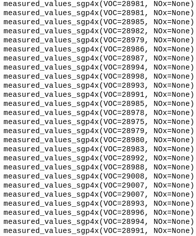

# SGP4X

[**На русском языке**](README_RU.md)

A pure MicroPython driver and Gas Index Algorithm implementation for the **Sensirion SGP40 and SGP41** indoor air quality sensors (VOC and NOx).

Unlike other basic wrappers that only output raw sensor ticks (`SRAW`), this repository includes a lightweight, pure-MicroPython port of the **Sensirion Gas Index Algorithm (`gas_index.py`)**, allowing you to calculate ready-to-use **VOC Index (1–500)** and **NOx Index (1–500)** directly on microcontrollers (ESP32, RP2040, STM32, etc.) without needing a full CPython environment.

## Key Features
* **Full SGP40 & SGP41 Support:** Reads raw signals (`SRAW_VOC` and `SRAW_NOx`) over I2C with CRC-8 verification.
* **Built-in Sensirion Gas Index Algorithm:** Converts raw ticks into standardized VOC (1–500, baseline 100) and NOx (1–500, baseline 1) indices directly on the microcontroller.
* **Temperature & Humidity Compensation:** Supports passing external temperature and relative humidity values for improved sensor accuracy.
* **Memory Optimized:** Uses `micropython.const()` and module-level constants to minimize RAM footprint.

---

## Sensors Overview

### SGP40
The SGP40 is a digital gas sensor designed for indoor air quality monitoring, primarily measuring volatile organic compounds (VOCs).
* **Interface:** I2C
* **Features:** Integrated micro-hotplate, humidity-compensated readings, high resistance to siloxanes and contaminating substances.
* **Applications:** Air purifiers, demand-controlled ventilation systems, smart thermostats and climate control.

### SGP41
The SGP41 integrates two metal-oxide (MOx) sensing elements in a single package to monitor both VOCs and oxidizing gases (NOx).
* **VOC measurement range:** 0 to 1,000 ppm (ethanol equivalent), response time < 10 s.
* **NOx measurement range:** 0 to 10 ppm (NO₂ equivalent), response time < 250 s.
* **Applications:** Professional air purifiers, kitchen range hoods, HVAC air exchange systems, smart air quality monitors.

---

## Gas Index Algorithm (`gas_index.py`)

Raw readings (`SRAW`) from the SGP40/SGP41 cannot be used directly as absolute ppm values. They must be processed through the **Sensirion Gas Index Algorithm** to adapt to the sensor's baseline and output a relative index from **1 to 500**:
* **VOC Index:** `100` represents average clean indoor air; `< 100` indicates cleaner air (e.g., after ventilation); `> 100` indicates increased VOC levels (solvents, cooking, human respiration).
* **NOx Index:** `1` represents clean air without nitrogen oxides; `> 1` indicates the presence of combustion byproducts, gas stove emissions, or traffic exhaust.

> **Important:** The algorithm expects a strict **1.0-second sampling interval** (`sampling_interval=1.0`). During the first **45 seconds** after startup (initial blackout/warm-up period), `get_gas_index()` returns `0` while internal filters stabilize.

Based on the official [Sensirion Gas Index Algorithm](https://pypi.org/project/sensirion-gas-index-algorithm/).

---

## Quick Start

### 1. Hardware Connection & Power
* **Supply Voltage:** `1.7V` to `3.6V` (3.3V logic recommended).
* **Wiring:** Connect `VCC`, `GND`, `SDA`, and `SCL` of the SGP40/SGP41 breakout board to the I2C pins of your MicroPython board.

### 2. Installation
Flash MicroPython firmware onto your board (ESP32, Raspberry Pi Pico / RP2040, STM32, etc.) and upload the following files to the root directory:
* `sgp4Xmod.py`
* `gas_index.py`
* `main.py`
* `sensor_pack_2/` (entire folder)

### 3. Usage Example

```python
import time
from machine import I2C, Pin
from sgp4Xmod import SGP4X
from sen_gas_index import GasIndexAlgorithm, ALGORITHM_TYPE_VOC, ALGORITHM_TYPE_NOX

# Initialize I2C (adjust pins for your board)
i2c = I2C(0, scl=Pin(22), sda=Pin(21), freq=100_000)
sensor = SGP4X(i2c)

# Initialize VOC and NOx index processors (1-second sampling interval)
voc_algo = GasIndexAlgorithm(ALGORITHM_TYPE_VOC, sampling_interval=1.0)
nox_algo = GasIndexAlgorithm(ALGORITHM_TYPE_NOX, sampling_interval=1.0)

while True:
    t_start = time.ticks_ms()

    # Read raw ticks from sensor
    raw_data = sensor.get_measurement_result()

    if isinstance(raw_data, tuple):  # SGP41 returns (sraw_voc, sraw_nox)
        sraw_voc, sraw_nox = raw_data
        voc_idx = voc_algo.get_gas_index(sraw_voc)
        nox_idx = nox_algo.get_gas_index(sraw_nox)
        print(f"VOC: {sraw_voc} (Index: {voc_idx}) | NOx: {sraw_nox} (Index: {nox_idx})")
    else:  # SGP40 returns sraw_voc only
        voc_idx = voc_algo.get_gas_index(raw_data)
        print(f"VOC: {raw_data} (Index: {voc_idx})")

    # Maintain a strict 1-second loop interval
    elapsed = time.ticks_diff(time.ticks_ms(), t_start)
    if elapsed < 1000:
        time.sleep_ms(1000 - elapsed)
```

---

## Troubleshooting Note (SGP41 returning `0xFF, 0xFF, 0xFF`)
When reading 6 bytes from some third-party SGP41 breakout boards, the first 3 bytes (VOC + CRC) may be valid while the second 3 bytes (NOx + CRC) return `0xFF, 0xFF, 0xFF`, causing a CRC exception. This commonly happens if the module actually houses an **SGP40** chip remarked as an SGP41.
* **Workaround:** Pass `sensor_id=0` to the `SGP4x` constructor (forcing SGP40 mode) and keep `check_crc=True`.

## Output Example

