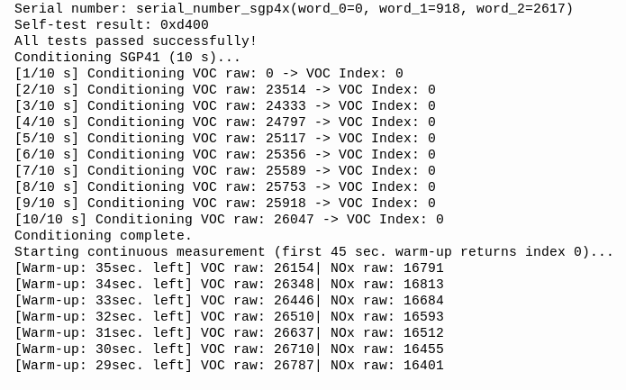
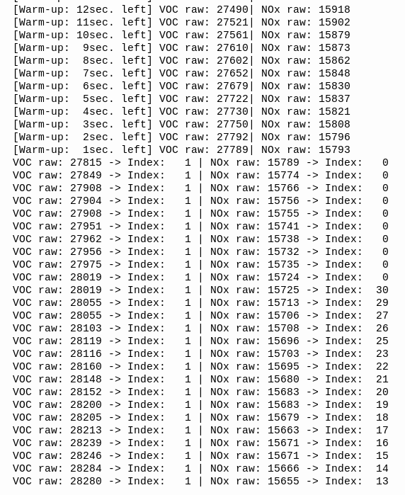
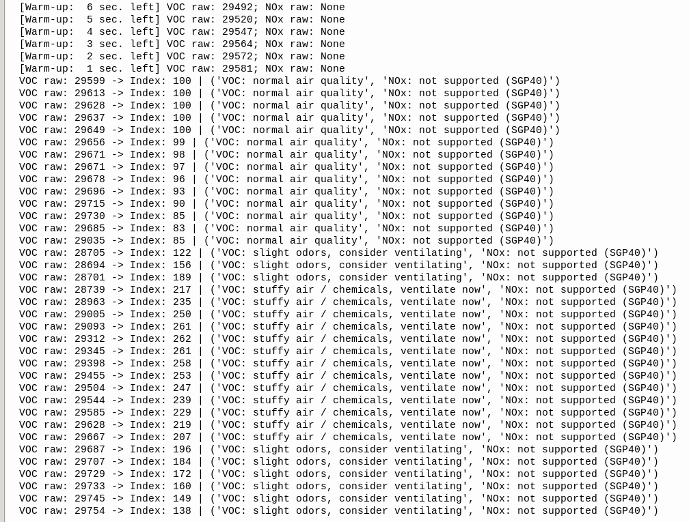

# SGP4X

[**In English**](README.md)

MicroPython модуль для управления датчиками качества окружающего воздуха **SGP40 / SGP41** от Sensirion, встроенный порт алгоритма расчёта газового индекса (**VOC Index**, **NOx Index**).

В отличие от некоторых драйверов, которые выдают только 'сырые' значения (`SRAW`), этот репозиторий содержит лёгкую реализацию **Sensirion Gas Index Algorithm (`sen_gas_index.py`)** на чистом MicroPython. Это позволяет вычислять готовые индексы **VOC (1–500)** и **NOx (1–500)** прямо на микроконтроллере (ESP32, RP2040, STM32 и др.) без использования ПК и полноценного Python 3.6+.

## Главные особенности
* **Полная поддержка SGP40 и SGP41:** чтение сырых данных (`SRAW_VOC` и `SRAW_NOx`) с проверкой контрольной суммы CRC-8.
* **Встроенный алгоритм Sensirion Gas Index:** преобразование сырых значений в стандартизированные индексы VOC (1–500, базовый уровень 100) и NOx (1–500, базовый уровень 1) непосредственно на микроконтроллере.
* **Компенсация температуры и влажности:** поддержка передачи внешних значений температуры и относительной влажности для повышения точности измерений.
* **Оптимизация памяти:** использование `micropython.const()` и констант уровня модуля для уменьшения расхода оперативной памяти (RAM).

---

# Назначение

**SGP40** это цифровой газовый датчик, предназначенный для контроля качества воздуха в помещениях. Его основная задача - измерение уровня летучих органических соединений (ЛОС / VOC) в воздухе.

## Особенности SGP40:
* шина I2C;
* встроенный нагреватель;
* показания качества воздуха с компенсацией влажности;
* устойчивость к загрязняющим веществам (силоксанам).

## Применение SGP40:
1. Очистители воздуха.
2. Системы вентиляции с автоматическим управлением.
3. Умные системы контроля микроклимата.

---

# SGP41

## Особенности SGP41:
1. Два газовых датчика (VOC и NOx) в одном корпусе.
2. Возможность автоматического управления воздушными очистительными системами и вытяжками.
3. Мониторинг потенциально опасных концентраций загрязняющих веществ и продуктов горения.

## Технические характеристики SGP41:
* Диапазон измерения ЛОС (VOC): от 0 до 1000 ppm (эквивалент этанола).
* Диапазон измерения NOx: от 0 до 10 ppm (эквивалент NO2).
* Время отклика: менее 10 секунд для ЛОС, менее 250 секунд для NOx.

## Области применения SGP41:
* Профессиональные очистители воздуха.
* Системы вентиляции и воздухообмена (HVAC).
* Кухонные вытяжки.
* Умные системы контроля качества воздуха.

---

# Обработка сырых данных (`sen_gas_index.py`)

Сырые показания (`SRAW`) датчиков SGP40 и SGP41 нельзя использовать напрямую как абсолютные значения в ppm. Для анализа и отображения пользователю они обрабатываются встроенным классом `GasIndexAlgorithm`, который адаптируется к фоновому уровню воздуха и формирует относительный индекс от **1 до 500**:
* **Индекс VOC:** `100` - нормальный чистый воздух в помещении; `< 100` - более свежий воздух (например, после проветривания); `> 100` - рост концентрации ЛОС (бытовая химия, готовка, дыхание людей).
* **Индекс NOx:** `1` - чистый воздух без оксидов азота; `> 1` - появление продуктов горения, выхлопных газов или испарений от газовой плиты.

> **Важно:** Алгоритм рассчитан на достаточно точный интервал опроса в **1.0 сек.** (`sampling_interval=1.0`). В течение первых **45 секунд** после запуска (период начального прогрева и стабилизации фильтров) метод `get_gas_index()` возвращает `0`.

Реализация основана на официальном алгоритме [Sensirion Gas Index Algorithm](https://pypi.org/project/sensirion-gas-index-algorithm/).

---

# Питание
Напряжение питания датчиков серии SGP4X составляет **1.7 – 3.6 В** (3.3 В рекомендуется).

# Прошивка и установка
Загрузите прошивку MicroPython на вашу плату (Arduino Nano, Raspberry Pi Pico RP2040, ESP32/ESP8266 и т. д.), а затем скопируйте в корень файловой системы следующие файлы:
* `main.py`
* `sgp4Xmod.py`
* `sen_gas_index.py`
* папку `sensor_pack_2` полностью

Затем откройте `main.py` в вашей IDE и запустите его.

# Подключение и пример использования

Подключите плату с датчиком SGP4X по шине I2C (`VCC`, `GND`, `SDA`, `SCL`) к микроконтроллеру с прошивкой MicroPython:

```python
import time
from machine import I2C, Pin
from sgp4Xmod import SGP4X
from sensor_pack_2.bus_service import I2cAdapter
from sen_gas_index import GasIndexAlgorithm, ALGORITHM_TYPE_VOC, ALGORITHM_TYPE_NOX

# Инициализация I2C (укажите пины вашей платы)
i2c = I2C(0, scl=Pin(22), sda=Pin(21), freq=400_000)
adaptor = I2cAdapter(i2c)

# sensor_id: 0 - SGP40, 1 - SGP41
sensor = SGP4X(adapter=adaptor, address=0x59, check_crc=True, sensor_id=1)

# Инициализация алгоритмов расчёта индексов VOC и NOx (интервал 1 секунда)
voc_algo = GasIndexAlgorithm(ALGORITHM_TYPE_VOC, sampling_interval=1.0)
nox_algo = GasIndexAlgorithm(ALGORITHM_TYPE_NOX, sampling_interval=1.0)

# Кондиционирование (ТОЛЬКО для SGP41, не более 10 секунд)
if 1 == sensor.get_sensor_id():
    for _ in range(10):
        sensor.execute_conditioning()
        time.sleep_ms(1000)

while True:
    t_start = time.ticks_ms()

    # Чтение сырых значений с датчика
    raw = sensor.measure_raw_signal()
    voc_idx = voc_algo.get_gas_index(raw.VOC)

    if raw.NOx is not None:  # SGP41
        nox_idx = nox_algo.get_gas_index(raw.NOx)
        print(f"VOC: {raw.VOC} (Index: {voc_idx}) | NOx: {raw.NOx} (Index: {nox_idx})")
    else:  # SGP40
        print(f"VOC: {raw.VOC} (Index: {voc_idx})")

    # Выдерживаем строгий интервал опроса в 1 секунду
    elapsed = time.ticks_diff(time.ticks_ms(), t_start)
    if elapsed < 1000:
        time.sleep_ms(1000 - elapsed)
```

## Внимание (особенность некоторых плат SGP41)
При работе с некоторыми сторонними модулями SGP41 в ответе на команду измерения считывается шесть байт: первые три байта содержат данные VOC (2 байта + CRC), а вторая тройка - данные NOx.
Если первая тройка проходит проверку CRC, а вторая тройка возвращает `0xFF, 0xFF, 0xFF` (вызывая исключение неверного CRC), вероятнее всего на плате распаян чип **SGP40** с перемаркировкой в SGP41!
* **Решение:** В этом случае передавайте в конструктор `sensor_id = 0` (режим SGP40) и оставляйте `check_crc = True`.

## Примеры вывода

### 1. Инициализация SGP41 и 10-секундное кондиционирование


### 2. Обратный отсчёт прогрева (стабилизация фильтров 45 с)


### 3. Отклик индекса VOC (выдох на сенсор)


## Лицензия и авторство

Этот проект распространяется по лицензии **MIT License**.

Модуль `sen_gas_index.py` представляет собой порт официального Python/MicroPython 
[Алгоритма индекса газа Sensirion (v3.2.0)] (https://github.com/Sensirion/gas-index-algorithm).

* **Исходные авторские права:** Авторские права (c) 2022, Sensirion AG.
* **Оригинальная лицензия:** Лицензия BSD из 3 пунктов.
* **Авторские права порта:** Copyright (c) 2024, Роман Шевчик

Исходная лицензия BSD из 3 пунктов требует сохранения уведомления об авторских правах.
Полный исходный текст лицензии и уведомления об авторских правах сохраняются в исходном файле `sen_gas_index.py`.